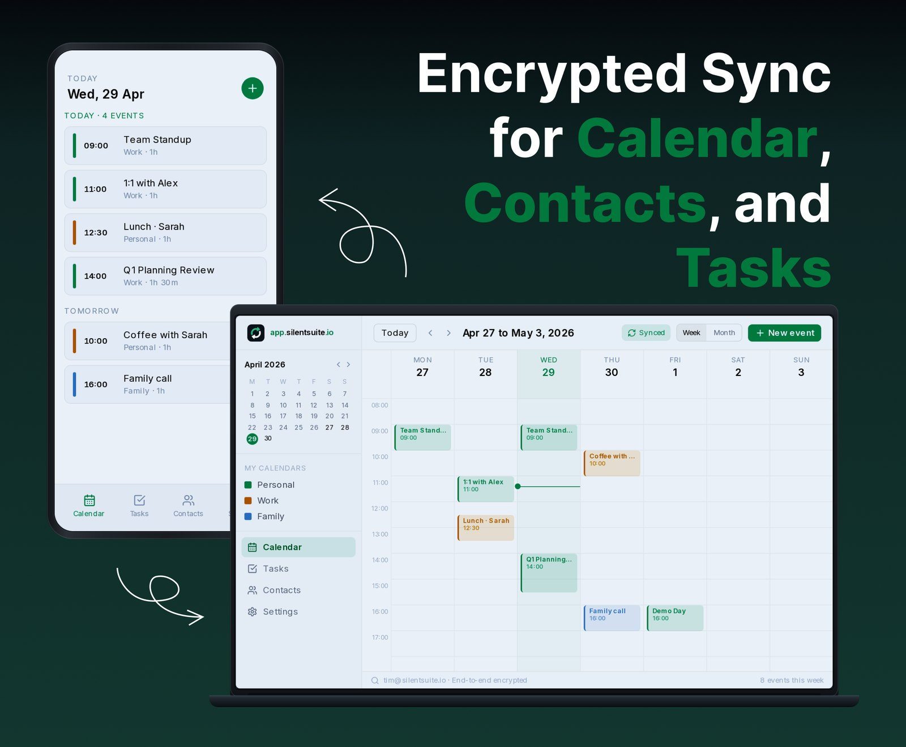

### Hi, I'm Tim

I build SilentSuite. Your calendar knows where you'll be, your contacts map who you know, and your task list says what you're about to do. I don't think a sync server should be able to read any of that, so SilentSuite encrypts it on your device first. The server only ever gets ciphertext.

It's open source and in public beta. Android, the web app, a desktop Bridge and self-hosting work today. iOS is still in development. There hasn't been an independent security audit yet; the [security page](https://silentsuite.io/security) explains the threat model and what the server can still see.

If something breaks on your phone or your DAV client, please [open an issue](https://github.com/silent-suite/silentsuite/issues). Real-device reports help more than anything else right now. Security reports go to info@silentsuite.io, not to public issues.

[silentsuite.io](https://silentsuite.io) · [docs.silentsuite.io](https://docs.silentsuite.io) · [app.silentsuite.io](https://app.silentsuite.io)

